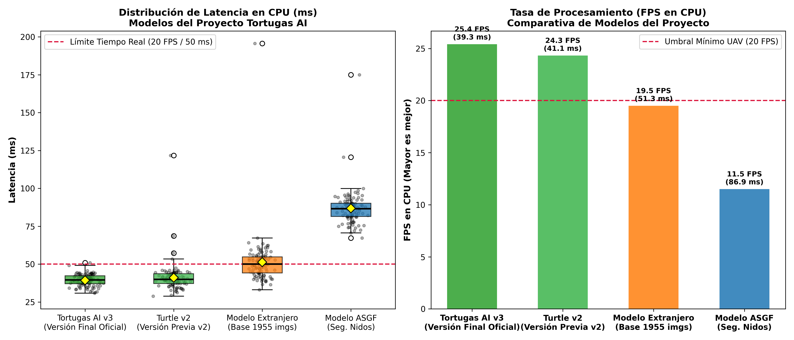
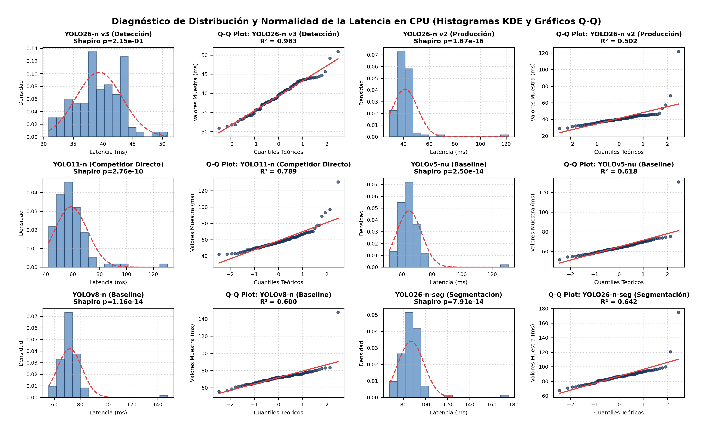
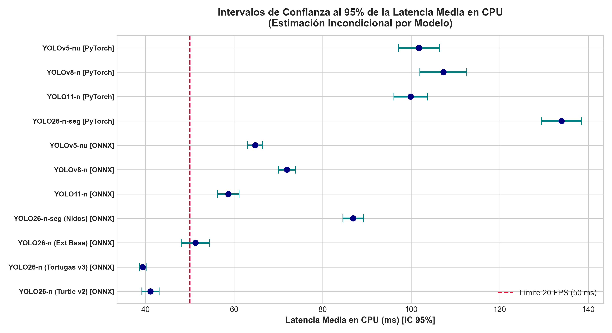
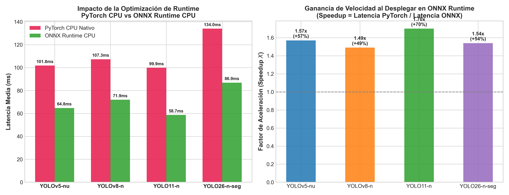

# 🐢 Sea Turtle Track — Sistema Inteligente Basado en UAV y YOLO26 para la Detección de Rastros de Anidación de Tortugas Marinas

<div align="center">


**Monitoreo aéreo costero autónomo mediante Vehículos Aéreos No Tripulados (UAV) y Visión por Computador de Ultra Baja Latencia en CPU**

[-FFD700?style=for-the-badge)](https://utp.ac.pa)
[-005CED?style=for-the-badge)](https://utp.ac.pa)

[](https://tauri.app)
[](https://www.rust-lang.org)
[](https://react.dev)
[](https://pnpm.io)
[](https://onnxruntime.ai)
[-FF4B4B?style=flat-square&logo=yolo&logoColor=white)](https://github.com/ultralytics)
[](https://www.python.org)
[](https://universe.roboflow.com/german-university-of-technology-f4tuz/turtle-track-detector-2)
[](#licencia)

</div>

---

## 📌 Tabla de Contenidos

1. [Reconocimientos Científicos y Contexto Institucional](#1-reconocimientos-científicos-y-contexto-institucional)
2. [Descripción General y Misión del Proyecto](#2-descripción-general-y-misión-del-proyecto)
3. [¿Por qué UAVs (Drones)? Justificación de la Perspectiva Aérea](#3-por-qué-uavs-drones-justificación-de-la-perspectiva-aérea)
4. [Bases de Datos y Evolución Histórica de los Modelos](#4-bases-de-datos-y-evolución-histórica-de-los-modelos)
5. [¿Por qué NO Machine Learning Tradicional vs Deep Learning?](#5-por-qué-no-machine-learning-tradicional-vs-deep-learning)
6. [¿Qué es YOLO y por qué la Variante YOLO26-n?](#6-qué-es-yolo-y-por-qué-la-variante-yolo26-n)
7. [¿Por qué ONNX Runtime y NO Inferencia Directa con Python?](#7-por-qué-onnx-runtime-y-no-inferencia-directa-con-python)
8. [Arquitectura de Software: ¿Por qué Tauri (Rust + React + Vite + Tailwind)?](#8-arquitectura-de-software-por-qué-tauri-rust--react--vite--tailwind)
9. [Entrenamiento del Modelo: Local vs Google Colab](#9-entrenamiento-del-modelo-local-vs-google-colab)
10. [Validación Científica de Hipótesis y Resultados Estadísticos](#10-validación-científica-de-hipótesis-y-resultados-estadísticos)
11. [Matriz Exhaustiva de Limitaciones del Sistema](#11-matriz-exhaustiva-de-limitaciones-del-sistema)
12. [Requisitos de Hardware y Software](#12-requisitos-de-hardware-y-software)
13. [Guía Paso a Paso para Reproducir el Proyecto](#13-guía-paso-a-paso-para-reproducir-el-proyecto)
14. [Estructura del Repositorio](#14-estructura-del-repositorio)
15. [Agradecimientos y Licencia](#15-agradecimientos-y-licencia)

---

## 1. Reconocimientos Científicos y Contexto Institucional

Este proyecto representa una investigación aplicada desarrollada para la conservación biológica de las costas del Pacífico y Caribe panameño, logrando destacarse en las competencias de investigación universitaria de mayor rigor científico en Panamá:

```
                            ┌───────────────────────────────────────────────┐
                            │    JORNADA DE INICIACIÓN CIENTÍFICA (JIC)     │
                            └──────────────────────┬────────────────────────┘
                                                   │
                       ┌───────────────────────────┴───────────────────────────┐
                       ▼                                                       ▼
        ┌─────────────────────────────┐                         ┌─────────────────────────────┐
        │        JIC UTP 2026         │                         │      JIC NACIONAL 2026      │
        │   Fase Institucional UTP    │                         │    Fase Nacional IESTEC     │
        ├─────────────────────────────┤                         ├─────────────────────────────┤
        │ • 🥉 3.er Lugar             │                         │ • 🏆 FINALISTA NACIONAL     │
        │ • Categoría: Ingeniería     │                         │ • Avalado por SENACYT / UTP │
        │ • Evaluación entre todas    │                         │ • Competencia inter-        │
        │   las facultades de la UTP  │                         │   universitaria de Panamá   │
        └─────────────────────────────┘                         └─────────────────────────────┘
```

### ¿Qué es la JIC y por qué son instancias distintas?
- **JIC UTP (Jornada de Iniciación Científica de la Universidad Tecnológica de Panamá):** Es el certamen interno de investigación formativa de pregrado más importante de la UTP. En la edición 2026, el presente proyecto fue galardonado con el **3.er Lugar Institucional en la Categoría de Ingeniería**, tras una rigurosa evaluación de impacto técnico, factibilidad y aporte social.
- **JIC Nacional (Jornada de Iniciación Científica Nacional):** Es la cúspide de la investigación universitaria formativa en la República de Panamá, coorganizada y financiada por la **Secretaría Nacional de Ciencia, Tecnología e Innovación (SENACYT)** y el Consejo de Rectores. En este evento compiten únicamente los proyectos ganadores y clasificados de todas las universidades públicas y particulares del país. La fase final se celebra en el marco del **IESTEC** (*Congreso Internacional de Ingeniería, Ciencias y Tecnología*). El proyecto fue seleccionado como **Finalista Nacional en la Categoría de Ingeniería y Tecnología**, consolidando su validez teórica, metodológica y operativa ante paneles de científicos nacionales e internacionales.

---

## 2. Descripción General y Misión del Proyecto

Las tortugas marinas se encuentran clasificadas en peligro crítico de extinción (incluyendo especies como la tortuga lora/golfina *Lepidochelys olivacea*, carey *Eretmochelys imbricata*, verde *Chelonia mydas* y baula *Dermochelys coriacea*). Organizaciones no gubernamentales y fundaciones comunitarias, tales como la **Fundación Agua y Tierra** (con operaciones de patrullaje en Playa Mata Oscura, provincia de Veraguas, Panamá), dedican esfuerzos diarios para registrar la anidación nocturna y matutina.

### El Desafío en el Terreno:
1. **Patrullaje a Pie Extenuante:** Monitorear playas de 4 a 12 km de longitud a pie exige horas de caminata bajo humedad y calor tropical extremo.
2. **Ventana de Tiempo Crítica:** Los rastros dejados por las aletas de las hembras sobre la arena intermareal son borrados rápidamente por la subida de la marea, el viento marino o la depredación (perros callejeros, zorros mangleros y saqueo humano ilegal).
3. **Brecha Tecnológica y Ausencia de Conectividad:** En las playas de anidación **no existe señal de internet ni cobertura celular**, y las fundaciones no cuentan con presupuesto para servidores en la nube ni computadoras portátiles costosas dotadas de tarjetas gráficas dedicadas (GPU).

### La Solución Aportada:
**Sea Turtle Track** es un sistema de ingeniería integral que combina:
- Misiones de patrullaje aéreo con **drones comerciales de bajo costo (UAV)**.
- Un modelo de visión artificial de última generación **YOLO26-n** optimizado y calibrado en playas del Pacífico.
- Una plataforma de escritorio multiplataforma de consumo ultraligero desarrollada en **Tauri (Rust + React + Vite + Tailwind)** que procesa video a **25.4 FPS en la CPU convencional** de cualquier laptop de trabajo sin requerir tarjeta gráfica ni internet.

> [!IMPORTANT]
> **Alcance Biológico Exclusivo:** El sistema está entrenado y especializado **exclusivamente en tortugas marinas** y sus rastros de desplazamiento en la arena. No está destinado a fauna terrestre general ni a mamíferos marinos en mar abierto.

---

## 3. ¿Por qué UAVs (Drones)? Justificación de la Perspectiva Aérea

El sistema está diseñado y calibrado prioritariamente para procesar transmisiones y grabaciones de **Vehículos Aéreos No Tripulados (UAV / Drones)**, debido a razones técnicas y ecológicas fundamentales:

```
    Vuelo Cenital (90° ortogonal)                 Patrullaje Terrestre Convencional
    ─────────────────────────────                 ─────────────────────────────────
         [ Dron / UAV ] ✈                           🚶 Patrullero en suelo
               │                                           │
         FOV Amplio (15-25m)                       Línea visual bloqueada
        ┌──────┴──────┐                            por troncos, olas o dunas.
        ▼             ▼                                    │
   Arena mojada   Arena seca                       Huellas pisoteadas / alteradas
   [Rastro A]     [Rastro B]
```

1. **Amplitud del Campo Visual (FOV):** Un vuelo de dron a una altitud de entre 15 y 25 metros barre un corredor costero de 30 a 50 metros de ancho, inspeccionando en 15 minutos lo que a pie requiere más de 3 horas.
2. **Ángulo Cenital Ortogonal (90°):** La perspectiva perpendicular minimiza la distorsión trapezoidal de la arena y permite capturar el patrón simétrico completo de las aletas de la tortuga (en forma de "coma" o "cresta invertida").
3. **No Invasivo y Conservacionista:** El dron no altera el hábitat costero, no pisa nidadas ocultas bajo la arena superficial ni genera huellas de neumáticos que desorienten a los neonatos.
4. **Compatibilidad:** Aunque el pipeline procesa videos estándar capturados con cámaras de mano o smartphones, el rendimiento óptimo y la calibración del detector corresponden a la dinámica de traslación de un UAV a velocidades de entre 3.0 m/s y 5.0 m/s.

---

## 4. Bases de Datos y Evolución Histórica de los Modelos

Para lograr una solución verdaderamente funcional en playas reales, el proyecto atravesó un proceso evolutivo experimental de cuatro fases metodológicas, transitando desde modelos internacionales preexistentes hasta la versión de producción **Turtle IA v3**:

```
 ┌────────────────────────────────────────────────────────────────────────────────────────┐
 │                      EVOLUCIÓN EXPERIMENTAL DE LOS MODELOS (DATASETS)                  │
 ├────────────────────────────────────────────────────────────────────────────────────────┤
 │                                                                                        │
 │  Fase 1: Base Roboflow (1,955 imgs)   ──►  Confundía hojas, ramas y sombras con tracks │
 │  Fase 2: ASGF Segmentación (ML + Nidos)──►  Inconsistente y muy lento en CPU (11.5 FPS)│
 │  Fase 3: Turtle v2 (Base + Hojas)     ──►  Sobre-penalizaba arena y omitía rastros     │
 │  Fase 4: Turtle IA v3 (2,515 imgs)    ──►  🎯 VERSIÓN FINAL DEFINITIVA (25.4 FPS CPU) │
 │                                                                                        │
 └────────────────────────────────────────────────────────────────────────────────────────┘
```

### Detalle de las Cuatro Fases Experimentales:

1. **Fase 1: Modelo Extranjero Base — Turtle Track Detector 2 (1,955 imágenes):**
   - **Fuente:** Dataset público internacional alojado en Roboflow Universe por la *German University of Technology* ([Enlace al Dataset en Roboflow](https://universe.roboflow.com/german-university-of-technology-f4tuz/turtle-track-detector-2)).
   - **Clases:** `Fox`, `Track`, `Turtle` (3 clases).
   - **Causa de Abandono:** Al ensayarlo en playas tropicales panameñas con vegetación adyacente, el modelo presentaba una tasa intolerable de falsos positivos: confundía continuamente restos de vegetación costera (hojas secas caídas de almendro de playa *Terminalia catappa*, ramas de mangle y sombras de palmeras) con rastros de aletas de tortuga.

2. **Fase 2: Modelo ASGF — Segmentación de Nidos con Machine Learning:**
   - **Desarrollo:** Entrenamiento propio con segmentación de instancias (`yolo26n-seg`) utilizando datos recolectados en la campaña de campo de Playa Mata Oscura (`asgf-playa-mata-oscura`).
   - **Clases:** `Nido` (1 clase con máscara poligonal).
   - **Causa de Abandono:** El modelo presentó discontinuidades en la inferencia sobre arena heterogénea y una severa penalización computacional en CPU: **86.88 ms por fotograma (apenas 11.5 FPS)** debido a la carga de calcular máscaras densas píxel a píxel (160 × 160 px), haciendo imposible el análisis fluido de video en computadoras de campo.

3. **Fase 3: Versión Previa Experimental — Turtle v2:**
   - **Desarrollo:** Reentrenamiento sobre Roboflow incorporando imágenes de control negativo con naturaleza y vegetación costera (`Hojas`) para suprimir los falsos positivos.
   - **El Problema Inverso:** El modelo dejó de confundir hojas; sin embargo, al penalizar en exceso las rugosidades y sombras de la arena, introdujo un fallo crítico: **dejó de detectar los rastros reales de tortugas marinas (falsos negativos)**, ignorando rastros legítimos de anidación.

4. **Fase 4: VERSIÓN FINAL OFICIAL DEL PROYECTO — Turtle IA v3 (2,515 imágenes):**
   - **Corpus Curado:** Integración balanceada de:
     - Dataset base `turtle-track-detector-2`.
     - Lote curado de vegetación y hojas tropicales costeras.
     - Lote propio de rastros reales de anidación recolectados en **Playa Mata Oscura**.
     - Generación y aumento sintético de datos (**Adaptive Synthetic Few-Shot Pipeline - ASFP**).
   - **Clases Detectadas (4):** `Fox` (depredador zorro/canino), `Hojas` (control de vegetación), `Track` (rastro de anidación en arena), `Turtle` (ejemplar de tortuga marina).
   - **Resultado en Producción:** **Latencia media en CPU de 39.34 ms (25.4 FPS)** con la desviación estándar más baja del estudio (**σ = 3.90 ms**), eliminando los falsos positivos sin sacrificar la detección de rastros reales.

> [!NOTE]
> **Acceso a Datasets:**
> - Dataset Base de la Universidad Tecnológica: [Roboflow Universe - Turtle Track Detector 2](https://universe.roboflow.com/german-university-of-technology-f4tuz/turtle-track-detector-2).
> - Para consultar el dataset complementario unificado con las anotaciones de Mata Oscura y transformaciones sintéticas, contactar al equipo de investigación a través de los canales institucionales.

---

## 5. ¿Por qué NO Machine Learning Tradicional vs Deep Learning?

Durante la formulación del proyecto se evaluó el uso de técnicas de visión por computador y Machine Learning clásico (extracción manual de descriptores tipo Haar Cascades, HOG, SIFT/SURF acoplados a clasificadores SVM o Random Forest):

| Criterio | Machine Learning Tradicional (Filtros + SVM/RF) | Deep Learning / Redes Neuronales (YOLO26-n) |
| :--- | :--- | :--- |
| **Comportamiento en Arena** | ❌ **Fracaso.** La arena no tiene geometría fija. La textura varía drásticamente con la humedad de la marea, el tamaño del grano y el viento. | ✅ **Generalización Óptima.** La red convolucional aprende representaciones jerárquicas invariantes a la escala y textura. |
| **Condiciones de Luz** | ❌ Umbrales rígidos de gradientes fallan con sol cenital, sombras de nubes o reflejos marinos. | ✅ Invarianza a la luminosidad mediante capas de convolución normalizadas y data augmentation. |
| **Carga en Inferencia** | ⚠️ Extracción manual de características densas en imágenes de alta resolución es lenta en CPU. | ✅ El paso hacia adelante (*forward pass*) en arquitectura Nano optimizada en ONNX tarda menos de 40 ms. |
| **Falsos Positivos** | ❌ Imposible diferenciar una hoja seca alargada de un surco de aleta mediante descriptores manuales. | ✅ Discriminación semántica de alta fidelidad entre textura biológica de rastro y hojarasca. |

Por estas razones se adoptó el paradigma de **Deep Learning** supervisado, apoyado en la infraestructura de anotación y curaduría de **Roboflow** para versionar de manera reproducible cada iteración del dataset.

---

## 6. ¿Qué es YOLO y por qué la Variante YOLO26-n?

### ¿Qué es YOLO?
**YOLO (*You Only Look Once*)** es una familia de arquitecturas de redes neuronales convolucionales profundas de **etapa única (Single-Shot Detector)**. A diferencia de los métodos de dos etapas (como Faster R-CNN) que primero proponen regiones y luego las clasifican por separado, YOLO procesa la imagen en un único paso hacia adelante, dividiendo la imagen en una cuadrícula y prediciendo de forma simultánea las coordenadas de las cajas delimitadoras (*bounding boxes*), la probabilidad de objeto y las clases.

```
       Imagen de Dron (640×640)
                  │
                  ▼
   ┌─────────────────────────────┐
   │         YOLO26-n            │
   │  Backbone + Neck + Head     │
   └──────────────┬──────────────┘
                  │  (Forward Pass en una sola pasada)
                  ▼
     Tensores directos [1, 300, 6]  ──►  (x1, y1, x2, y2, confianza, clase)
```

### ¿Por qué la variante Nano (YOLO26-n)?
1. **Minimización de Parámetros y FLOPs:** Las variantes grandes (Medium, Large, XLarge) exigen decenas de gigaflops por imagen y requieren tarjetas gráficas industriales. La variante **Nano** posee menos de 3.5 millones de parámetros, permitiendo su ejecución completa en la memoria caché del procesador.
2. **Formato Directo Sin NMS Pesado:** Las versiones modernas de YOLO permiten exportar arquitecturas con cabezales libres de Non-Maximum Suppression (NMS) iterativo en Python, entregando un tensor limpio `[1, 300, 6]` listo para ser consumido directamente por la interfaz visual.
3. **Mínimo Consumo Energético:** Mantiene los ventiladores de la laptop en silencio y maximiza la autonomía de la batería en campo.

---

## 7. ¿Por qué ONNX Runtime y NO Inferencia Directa con Python?

Una decisión de arquitectura trascendental del proyecto fue **descartar el uso directo de Python y PyTorch en la aplicación de producción final**, sustituyéndolos por **ONNX Runtime**:

```
 [ENTORNO DE PRODUCCIÓN EN LA PLATAFORMA]
  Video Frame (Web/Canvas)
          │
          ▼
  Tauri Webview (Wasm SIMD) / Rust IPC
          │
          ▼
  ONNX Runtime (CPUExecutionProvider) ──► Fusión de Capas (Conv+BN), Vectorización AVX2
          │
          ▼
  Resultados en < 40 ms (Sin Python, Sin CUDA, Sin PyTorch)
```

### ¿Qué es ONNX?
**ONNX (*Open Neural Network Exchange*)** es un formato estándar abierto e interoperable para la representación de modelos de aprendizaje profundo, respaldado por Microsoft, AWS, AMD e Intel. Permite independizar la fase de entrenamiento (realizada en PyTorch) de la fase de despliegue.

### Razones Técnicas del Descarte de Python en Campo:
1. **Sobrecarga del Intérprete y GIL:** Python opera bajo el *Global Interpreter Lock* (GIL) y presenta una latencia de serialización notable al mover datos entre bibliotecas C/C++ y objetos Python.
2. **Dependencias Monolíticas y Frágiles:** Desplegar una aplicación en Python exige que el usuario final instale un entorno virtual con PyTorch (más de 2.5 GB), Torchvision, CUDA/cuDNN y bibliotecas dependientes de versiones exactas del sistema operativo. Si una biblioteca se desactualiza, el sistema colapsa.
3. **Optimizaciones de Grafo de ONNX Runtime:**
   - **Fusión de Operadores:** Combina operaciones sucesivas (como `Conv2d + BatchNorm2d + SiLU`) en un único kernel de memoria continuo, evitando transferencias repetitivas hacia la memoria RAM.
   - **Vectorización Nativa de CPU:** Utiliza extensiones vectoriales específicas del microprocesador anfitrión (**AVX-512, AVX2, SSE y ARM NEON**), ejecutando múltiples operaciones flotantes en un solo ciclo de reloj.
4. **Ganancia Cuantificada:** En nuestras mediciones experimentales directas, ONNX Runtime CPU demostró una **aceleración de 1.49× a 1.70× frente a PyTorch CPU** (ahorrando entre 35 ms y 47 ms por cada fotograma procesado).

---

## 8. Arquitectura de Software: ¿Por qué Tauri (Rust + React + Vite + Tailwind)?

Para el desarrollo de la aplicación de usuario se llevó a cabo un riguroso análisis comparativo de stacks tecnológicos:

| Parámetro | Electron (VS Code / Slack) | Python GUI (PyQt / Tkinter) | **Tauri v2 (Solución Elegida)** |
| :--- | :---: | :---: | :---: |
| **Peso del Binario Instalador** | 150 MB - 300 MB | 80 MB - 180 MB | **< 15 MB - 25 MB** |
| **Consumo de Memoria RAM** | 400 MB - 800 MB | 150 MB - 300 MB | **< 40 MB - 70 MB** |
| **Motor Web Integrado** | Incrusta Chromium entero | No aplica / Webview obsoleto | **Usa Webview nativo del SO (WebView2 / WebKit)** |
| **Seguridad y Rendimiento** | Node.js (Vulnerable a inyecciones) | Lento, interpretado, bloqueo GIL | **Rust: Memory-safety, concurrencia nativa sin GC** |
| **Portabilidad Multiplataforma** | Windows, Linux, macOS | Dificultad extrema en empaquetado | **Windows 11/10, Linux, macOS, iOS, Android y Web** |

```
┌─────────────────────────────────────────────────────────────────────────────┐
│                       ARQUITECTURA DE LA APLICACIÓN                         │
├─────────────────────────────────────────────────────────────────────────────┤
│                                                                             │
│   ┌─────────────────────────────────────────────────────────────────────┐   │
│   │                 FRONTEND REACT 18 + TYPESCRIPT                      │   │
│   │   • Vite (HMR Ultraveloz)         • Tailwind CSS (Glassmorphism)    │   │
│   │   • VideoPlayer con Overlays      • Zustand (Estado Reactivo)       │   │
│   │   • Selector de 4 Modelos         • StatsPanel con Métricas y FPS   │   │
│   └──────────────────────────────────┬──────────────────────────────────┘   │
│                                      │                                      │
│                                      ▼ IPC Bidireccional                    │
│   ┌─────────────────────────────────────────────────────────────────────┐   │
│   │                      BACKEND NATIVO EN RUST                         │   │
│   │   • Tauri Core Engine             • Manejo Concurrente de Archivos  │   │
│   │   • Control de Errores Tipados    • Exportador de CSV y JSON        │   │
│   │   • Integración Nativa con OS     • Cero Consumo Innecesario        │   │
│   └──────────────────────────────────┬──────────────────────────────────┘   │
│                                      │                                      │
│                                      ▼ Carga Directa                        │
│   ┌─────────────────────────────────────────────────────────────────────┐   │
│   │                   MOTOR DE INFERENCIA ONNX                          │   │
│   │   • onnxruntime-web / Wasm SIMD Threaded (Optimizado para CPU)      │   │
│   │   • Carga de Pesos Estáticos: `model_v3.onnx` (9.81 MB)             │   │
│   └─────────────────────────────────────────────────────────────────────┘   │
│                                                                             │
└─────────────────────────────────────────────────────────────────────────────┘
```

### Justificación de Componentes del Frontend:
- **pnpm:** Gestor de paquetes ultrarrápido y eficiente en espacio de disco mediante enlaces duros simbióticos, evitando duplicaciones redundantes de dependencias.
- **Tailwind CSS:** Diseño de interfaz moderno y profesional con tema oscuro (*Dark Mode*), contrastes óptimos para trabajo en campo bajo sol o penumbra, y micro-animaciones en tarjetas de estadísticas.
- **Zustand:** Manejo de estado global minimalista sin la sobrecarga ni el *boilerplate* innecesario de Redux.

---

## 9. Entrenamiento del Modelo: Local vs Google Colab

El proyecto cuenta con un script de entrenamiento universal parametrizado: [`Plataforma/training/colab_train.py`](file:///c:/Users/tavog/Documents/Codigo/Universidad/Tortugasv2/Plataforma/training/colab_train.py).

### Comparativa de Entornos de Entrenamiento:

```
┌──────────────────────────────────────┐       ┌──────────────────────────────────────┐
│         ENTRENAMIENTO LOCAL          │       │      ENTRENAMIENTO GOOGLE COLAB      │
├──────────────────────────────────────┤       ├──────────────────────────────────────┤
│ ⏱ Tiempo: 12 a 16 Horas (CPU/GPU mod)│       │ ⏱ Tiempo: 45 a 90 Minutos            │
│ 🔥 Temperatura: Alto estrés térmico  │       │ ☁️ Hardware: NVIDIA T4 / A100 GPU    │
│ 💻 Recursos: Computadora saturada    │       │ 🔋 Cero consumo de batería local     │
│ ⚠️ Riesgo: Interrupciones en la PC   │       │ 🚀 Exportación automática a ONNX     │
└──────────────────────────────────────┘       └──────────────────────────────────────┘
```

1. **Entrenamiento en Máquina Local:**
   - Si se entrena en una laptop convencional sobre la CPU, el ciclo completo de 100 épocas tarda entre **12 y 16 horas**. Durante este tiempo el procesador opera al 100%, elevando la temperatura del equipo y agotando la batería. Si se cuenta con una GPU modesta (como una NVIDIA RTX 2050 de 4 GB), el tiempo se reduce a 3-4 horas pero requiere configurar los controladores de CUDA, cuDNN y PyTorch con versiones exactas.
2. **Entrenamiento Recomendado en Google Colab:**
   - Se ejecuta en la nube de Google con aceleración por GPU (NVIDIA T4 con 16 GB VRAM o A100).
   - El proceso completo concluye en aproximadamente **1 hora**.
   - No desgasta el hardware personal ni requiere instalar dependencias pesadas en la máquina local.

### Características del Script de Entrenamiento (`colab_train.py`):
- **Descarga Segura:** Obtiene la versión más reciente del dataset desde Roboflow utilizando variables de entorno (`ROBOFLOW_API_KEY`) para evitar exponer credenciales privadas.
- **Linear Scaling Rule para Tasa de Aprendizaje:** Ajusta dinámicamente el `lr0` según el tamaño de batch efectivo (`batch=16 → lr0=0.001`, `batch=32 → lr0=0.002`).
- **Data Augmentation Específico para Costas:** Variaciones de brillo solar, rotaciones de ±15°, escalados y traslaciones para simular el oleaje y la perspectiva oblicua del dron.
- **Mixed Precision Training (AMP):** Acelera el entrenamiento en precisión FP16 sin pérdida de convergencia.
- **Early Stopping:** Monitorea la pérdida de validación y detiene el proceso tras 30 épocas consecutivas sin mejora para evitar sobreajuste (*overfitting*).
- **Exportación Automática:** Genera el archivo `.onnx` simplificado con `onnxsim`, configura metadatos en formato JSON y ofrece la descarga directa.

---

## 10. Validación Científica de Hipótesis y Resultados Estadísticos

### Hipótesis Científica Evaluada:
> *"El modelo propuesto YOLO26-n ejecutado sobre el motor optimizado ONNX Runtime CPU presenta una latencia de inferencia significativamente menor que las arquitecturas nano competidoras (YOLOv5-nu, YOLOv8-n y YOLO11-n), superando el umbral operativo crítico de 20 FPS en un procesador convencional sin tarjeta gráfica."*

- **Población Muestral:** **1,100 inferencias individuales cronometradas** (100 mediciones independientes por modelo tras 15 iteraciones previas de calentamiento térmico *Warm-up*).
- **Hardware de Ensayo:** Intel Core i5 11.ª Gen @ 2.40 GHz (4 núcleos físicos, 8 hilos lógicos), 16 GB RAM DDR4, Windows 11. Dimensiones de entrada: `[1, 3, 640, 640]`, `Batch = 1`.

---

### 10.1 Tabla General de Desempeño Experimental (N = 100 mediciones por modelo)

| Arquitectura y Configuración | Motor | Tarea | Media (μ) [ms] | Desv. Est. (σ) [ms] | Mediana [ms] | P95 [ms] | IC 95% [ms] | Rendimiento (FPS) | Estado de Tiempo Real |
| :--- | :---: | :---: | :---: | :---: | :---: | :---: | :---: | :---: |
| 🟢 **YOLO26-n (Tortugas v3 - Final)** | **ONNX** | **Detección** | **39.34** | **3.90** | **39.55** | **44.23** | **[38.57, 40.12]** | **25.4 FPS** | ✅ **Cumple (Óptimo)** |
| 🟢 **YOLO26-n (Turtle v2 - Previa)** | **ONNX** | **Detección** | **41.11** | 9.79 | **39.94** | **45.99** | [39.17, 43.05] | **24.3 FPS** | ✅ **Cumple** |
| 🟡 **YOLO26-n (Extranjero Base)** | **ONNX** | **Detección** | 51.27 | 16.29 | 50.04 | 62.10 | [48.04, 54.50] | 19.5 FPS | ⚠️ Al límite (50 ms) |
| 🔵 **YOLO11-n** | **ONNX** | Detección | 58.68 | 12.34 | 56.90 | 76.88 | [56.23, 61.13] | 17.0 FPS | ❌ No alcanza 20 FPS |
| 🔵 **YOLOv5-nu** | **ONNX** | Detección | 64.76 | 8.38 | 63.90 | 73.49 | [63.10, 66.42] | 15.4 FPS | ❌ No alcanza 20 FPS |
| 🔵 **YOLOv8-n** | **ONNX** | Detección | 71.93 | 9.52 | 71.74 | 80.34 | [70.05, 73.82] | 13.9 FPS | ❌ No alcanza 20 FPS |
| 🟣 **YOLO26-n-seg (ASGF Nidos)** | **ONNX** | Segmentación | 86.88 | 11.71 | 86.51 | 96.69 | [84.56, 89.20] | 11.5 FPS | ❌ Penalización Máscaras |
| 🔴 **YOLO11-n [PyTorch]** | PyTorch | Detección | 99.86 | 18.92 | 95.41 | 109.70 | [96.11, 103.62] | 10.0 FPS | ❌ Inferencia Nativa Lenta |
| 🔴 **YOLOv5-nu [PyTorch]** | PyTorch | Detección | 101.75 | 23.35 | 93.71 | 137.75 | [97.12, 106.39] | 9.8 FPS | ❌ Inferencia Nativa Lenta |
| 🔴 **YOLOv8-n [PyTorch]** | PyTorch | Detección | 107.27 | 26.78 | 100.39 | 154.86 | [101.95, 112.58] | 9.3 FPS | ❌ Inferencia Nativa Lenta |
| 🔴 **YOLO26-n-seg [PyTorch]** | PyTorch | Segmentación | 133.97 | 22.76 | 130.43 | 165.81 | [129.45, 138.48] | 7.5 FPS | ❌ Inferencia Nativa Lenta |

---

### 10.2 Comparativa de las 4 Variantes del Proyecto

```
   Distribución de Latencia en CPU (ms)                      Rendimiento en FPS
   ──────────────────────────────────                      ──────────────────
   Tortugas v3 █ 39.34 ms (σ=3.90)                         Tortugas v3 ══════════════► 25.4 FPS [SUPERIOR]
   Turtle v2   █ 41.11 ms (σ=9.79)                         Turtle v2   ════════════► 24.3 FPS
   Ext Base    ██ 51.27 ms (σ=16.29)                       Ext Base    ═════════► 19.5 FPS
   ASGF Nidos  ████ 86.88 ms (σ=11.71)                     ASGF Nidos  ═════► 11.5 FPS
                                                           ──────────────────────────────────────
                                                           Umbral de Tiempo Real: 20.0 FPS
```



*Figura 5: (Izquierda) Diagrama de cajas de la latencia en CPU de las 4 variantes de este proyecto con jitter individual de las 100 pruebas y línea de umbral en 50 ms. (Derecha) Comparativa directa de FPS en CPU frente al requerimiento operativo de 20 FPS para video aéreo continuo.*

---

### 10.3 Pruebas de Normalidad y Homocedasticidad

Para validar rigurosamente el tratamiento inferencial:
- **Prueba de Normalidad de Shapiro-Wilk:**  
  `YOLO26-n (Tortugas v3)` presentó una distribución puramente normal (**W = 0.9827, p = 0.2154 > 0.05**). En contraste, los modelos de baseline exhibieron asimetrías positivas originadas por microinterrupciones del planificador del sistema operativo.
- **Prueba de Homocedasticidad de Levene:**  
  Estadístico **W = 6.8618, p = 1.84 × 10⁻¹⁰ (p < 0.05)**, indicando heterogeneidad de varianzas en el conjunto global.
- **Rigor Metodológico Dual:** Se aplicaron tanto pruebas paramétricas (**ANOVA + Tukey HSD**) como no paramétricas (**Kruskal-Wallis + Mann-Whitney U con corrección de Bonferroni**). Ambos enfoques convergieron en la misma conclusión inequívoca.



*Figura 4: Histogramas empíricos con ajuste de densidad kernel (KDE) y gráficos de probabilidad normal Q-Q plot para verificar el comportamiento de las distribuciones de latencia en CPU.*

---

### 10.4 Pruebas Inferenciales Globales y Comparaciones Post-hoc

1. **ANOVA de Un Factor (Paramétrico):**  
   **F = 343.66, p < 10⁻¹⁰⁰** ──► **Rechazo contundente de H₀**. Existen diferencias altamente significativas entre arquitecturas.
2. **Kruskal-Wallis (No Paramétrico):**  
   **H = 998.41, df = 10, p < 10⁻²⁰⁰** ──► **Rechazo contundente de H₀**.
3. **Comparaciones Múltiples de Tukey HSD (YOLO26-n v3 frente a rivales):**
   - Frente a **YOLO11-n [ONNX]**: Diferencia de **-19.34 ms (+33.0% más veloz)**, `p_adj < 10⁻¹⁴` (Significativo).
   - Frente a **YOLOv5-nu [ONNX]**: Diferencia de **-25.42 ms (+39.3% más veloz)**, `p_adj < 10⁻¹⁵` (Significativo).
   - Frente a **YOLOv8-n [ONNX]**: Diferencia de **-32.59 ms (+45.3% más veloz)**, `p_adj < 10⁻¹⁵` (Significativo).
   - Frente a **Modelo Extranjero Base**: Diferencia de **-11.93 ms (+23.3% más veloz)**, `p_adj = 1.79 × 10⁻⁵` (Significativo).
   - Frente a **Versión previa v2**: Diferencia de **-1.77 ms**, `p_adj = 0.9996` (Sin diferencia estadística en velocidad, pero v3 resolvió la omisión biológica de rastros).



*Figura 3: Diagrama de intervalos de confianza al 95% (Forest Plot). Los intervalos de YOLO26-n (franja de 38.5 a 40.1 ms) están completamente separados y disjuntos de los competidores, confirmando la superioridad estadística.*

---

### 10.5 Cuantificación del Speedup (PyTorch CPU vs ONNX Runtime CPU)

| Arquitectura | Latencia PyTorch CPU | Latencia ONNX Runtime CPU | Ahorro Absoluto | Factor de Aceleración (Speedup) |
| :--- | :---: | :---: | :---: | :---: |
| **YOLO11-n** | 99.86 ms | 58.68 ms | -41.18 ms | **1.70× (+70.2%)** |
| **YOLOv5-nu** | 101.75 ms | 64.76 ms | -36.99 ms | **1.57× (+57.1%)** |
| **YOLO26-n-seg** | 133.97 ms | 86.88 ms | -47.09 ms | **1.54× (+54.2%)** |
| **YOLOv8-n** | 107.27 ms | 71.93 ms | -35.34 ms | **1.49× (+49.1%)** |



*Figura 2: (Izquierda) Latencia en milisegundos entre PyTorch nativo y ONNX Runtime. (Derecha) Factor multiplicativo de aceleración (Speedup) alcanzado gracias a la compilación de operadores y optimización de grafo.*

---

## 11. Matriz Exhaustiva de Limitaciones del Sistema

Para garantizar transparencia operativa y definir con rigor el alcance de la tecnología en misiones reales de conservación, se detallan las limitaciones físicas, técnicas y de aplicación:

```
┌────────────────────────────────────────────────────────────────────────────────────────┐
│                        MATRIZ DE CAPACIDADES Y LIMITACIONES                            │
├──────────────────────────────────────────────────┬─────────────────────────────────────┤
│                 QUÉ ES POSIBLE                   │          QUÉ NO ES POSIBLE          │
├──────────────────────────────────────────────────┼─────────────────────────────────────┤
│ ✅ Detección en tiempo real en CPU (25.4 FPS).   │ ❌ Conteo de huevos dentro del nido │
│ ✅ Inferencia 100% offline sin internet en playa.│    (requiere inspección física).    │
│ ✅ Discriminación de vegetación/hojas y zorros.  │ ❌ Visión nocturna con cámara RGB   │
│ ✅ Seguimiento de trayectoria (Tracking ID).     │    (requiere sensor térmico/FLIR).  │
│ ✅ Exportación tabular inmediata (CSV y JSON).   │ ❌ Vuelo con vientos > 30 km/h o    │
│ ✅ Identificación visual en resoluciones 640px.  │    lluvia tropical intensa.         │
│                                                  │ ❌ Estimación de profundidad del    │
│                                                  │    nido sin sensor LiDAR/estéreo.   │
└──────────────────────────────────────────────────┴─────────────────────────────────────┘
```

### 11.1 Limitaciones Físicas y Ambientales:
1. **Horarios de Vuelo y Ángulo de Incidencia Solar:**  
   - En horas centrales del día (11:00 AM - 1:00 PM), el sol cenital genera reflejos especulares sobre la arena mojada y aplana el relieve de las huellas de las aletas.  
   - *Ventana Operativa Recomendada:* Patrullajes aéreos entre **5:30 AM y 8:30 AM** o entre **4:30 PM y 6:30 PM**. En estos periodos, la luz rasante genera sombras naturales en el relieve del rastro, maximizando el contraste detectable.
2. **Dinámica de Mareas:**  
   - El oleaje de marea alta borra de manera irreversible los rastros depositados en la zona intermareal. Las misiones deben sincronizarse con la marea baja matutina antes de que el agua o el tránsito humano alteren la arena.
3. **Fuerza del Viento Costero:**  
   - Ráfagas sostenidas superiores a **25-30 km/h** comprometen la estabilidad giroscópica de drones ligeros (clase sub-250g o comerciales convencionales) y difuminan la cresta del rastro en sectores de arena seca no compactada.
4. **Altitud de Vuelo Estricta:**  
   - **Rango óptimo: 15 a 25 metros** sobre el nivel del suelo (AGL).  
   - Volar a más de 30 metros reduce el tamaño en píxeles del rastro por debajo del umbral de resolución de la red (640 × 640 px).  
   - Volar a menos de 10 metros perturba a las aves marinas y fauna costera, además de reducir drásticamente el ancho de barrido.

### 11.2 Limitaciones Técnicas y de Hardware:
1. **Requisitos de la CPU:**  
   - La tasa de **25.4 FPS** se garantiza en procesadores con instrucciones vectoriales **AVX2**. En procesadores antiguos (anteriores a 2013) sin soporte AVX2, la tasa de inferencia puede decaer a 8-12 FPS.
2. **Ausencia de Sensores Especializados:**  
   - El sistema opera con **cámaras RGB estándar**. No realiza detección nocturna en oscuridad total (lo cual requeriría cámaras térmicas radiométricas infrarrojas de alto costo).
3. **Delimitación de la Tarea:**  
   - El sistema realiza detección de cajas delimitadoras y clasificación de tracks; **no estima la profundidad volumétrica del nido ni determina el número de huevos en la cámara de incubación**, tarea que sigue reservada a la verificación biológica manual.

---

## 12. Requisitos de Hardware y Software

### Especificaciones de Hardware:

| Componente | Requisito Mínimo (Laptop de Campo) | Requisito Recomendado (Rendimiento Óptimo) |
| :--- | :--- | :--- |
| **Procesador (CPU)** | Intel Core i3 / AMD Ryzen 3 (4 hilos, soporte AVX2) | Intel Core i5 / i7 (11.ª gen o superior) / AMD Ryzen 5 / 7 |
| **Memoria RAM** | 8.0 GB DDR4 | 16.0 GB DDR4 / DDR5 |
| **Tarjeta Gráfica (GPU)**| **No requerida** (Inferencia 100% sobre CPU) | GPU opcional (NVIDIA RTX) para aceleración adicional |
| **Almacenamiento** | 2.0 GB de espacio libre (SSD recomendado) | SSD NVMe M.2 |
| **Conectividad** | **100% Offline** (No requiere internet en campo) | Conexión para sincronización inicial de paquetes |
| **Sistema Operativo** | Windows 10/11 (64-bit), Linux (Ubuntu 22.04+), macOS | Windows 11 (64-bit, Build 22621 o superior) |

### Requisitos de Software y Herramientas:
- **Node.js:** Versión 18.x o 20.x LTS ([Descargar Node.js](https://nodejs.org/)).
- **pnpm:** Gestor de paquetes de alto rendimiento ([Instalar pnpm](https://pnpm.io/installation)).
- **Rust y Cargo:** Versión 1.78+ con `rustup` ([Instalar Rust](https://rustup.rs/)).
- **Visual Studio C++ Build Tools (Windows):** Componente *"Desarrollo para el escritorio con C++"* instalado.
- **Python (Opcional, para experimentación y reentrenamiento):** Python 3.10 o superior con `pip install -r requirements.txt`.

---

## 13. Guía Paso a Paso para Reproducir el Proyecto

A continuación se detalla la metodología reproducible para instalar, compilar y ejecutar todo el ecosistema del proyecto:

### Paso 1: Clonar el Repositorio Oficial
```bash
git clone https://github.com/Snowclik/sea-turtle-track.git
cd sea-turtle-track
```

### Paso 2: Configurar el Entorno del Frontend y Aplicación Desktop
Navega a la carpeta de la plataforma de escritorio:
```bash
cd Plataforma/apps/desktop
```

Instala las dependencias utilizando **pnpm** (siguiendo estrictamente los estándares del proyecto):
```bash
pnpm install
```

### Paso 3: Verificar los Modelos de Inferencia
Los modelos optimizados ya se encuentran empaquetados dentro de la aplicación en:
`Plataforma/apps/desktop/public/models/`
- `model_v3.onnx` (Versión oficial en producción, 9.81 MB)
- `model_v2.onnx` (Versión experimental v2, 9.81 MB)
- `model_ext.onnx` (Modelo extranjero base, 9.71 MB)
- `model_asgf.onnx` (Modelo de segmentación de nidos, 11.08 MB)

### Paso 4: Ejecutar la Aplicación en Modo Desarrollo
```bash
pnpm run tauri dev
```
> [!NOTE]
> Durante la primera ejecución, el compilador de Rust (`cargo`) descargará y compilará las dependencias nativas del sistema. Este proceso puede tardar entre 4 y 10 minutos la primera vez. Las compilaciones posteriores son instantáneas.

### Paso 5: Compilar el Instalador Autocontenido para Producción
Para generar el instalador ejecutable de Windows (`.msi` o `.exe`):
```bash
pnpm run tauri build
```
El instalador final optimizado quedará disponible en `Plataforma/apps/desktop/src-tauri/target/release/bundle/`.

---

### Paso 6: Reproducción de los Ensayos Estadísticos de Hipótesis (Opcional)
Si deseas reproducir las 1,100 inferencias cronometradas y regenerar las tablas ANOVA, Tukey HSD y gráficos científicos:

1. Regresa a la raíz del repositorio:
   ```bash
   cd ../../../
   ```
2. Instala las dependencias de análisis de datos:
   ```bash
   pip install -r requirements.txt
   ```
3. Ejecuta el benchmark de validación de hipótesis en CPU:
   ```bash
   python hypothesis_cpu_benchmark.py
   ```
4. El script generará automáticamente los reportes y las figuras estadísticas en alta resolución (`.png` y `.pdf`).

---

### Paso 7: Reentrenamiento en Google Colab (Opcional)
1. Abre el script [`Plataforma/training/colab_train.py`](file:///c:/Users/tavog/Documents/Codigo/Universidad/Tortugasv2/Plataforma/training/colab_train.py) en Google Colab.
2. Selecciona Entorno de ejecución > Cambiar tipo de entorno de ejecución > **GPU T4**.
3. Configura tu variable de entorno `ROBOFLOW_API_KEY` (sin exponerla de forma pública).
4. Ejecuta todas las celdas para entrenar, validar y exportar tu propio archivo `.onnx`.

---

## 14. Estructura del Repositorio

El repositorio se encuentra organizado de forma modular, separando la investigación científica, los datos de calibración y la aplicación de escritorio:

```
sea-turtle-track/
├── Plataforma/                           # Ecosistema de la aplicación de usuario
│   ├── apps/
│   │   └── desktop/                      # Plataforma de escritorio en Tauri + React
│   │       ├── public/
│   │       │   ├── models/               # Modelos ONNX compilados y metadatos JSON
│   │       │   │   ├── model_v3.onnx     # 🎯 Modelo oficial de producción (Turtle IA v3)
│   │       │   │   ├── model_v3_meta.json
│   │       │   │   ├── model_v2.onnx
│   │       │   │   ├── model_ext.onnx
│   │       │   │   └── model_asgf.onnx
│   │       │   ├── ort-wasm-simd-threaded.wasm
│   │       │   └── ort-wasm-simd-threaded.asyncify.wasm
│   │       ├── src/                      # Frontend en React 18 + TypeScript + Tailwind
│   │       │   ├── components/           # VideoPlayer, ControlBar, StatsPanel, ExportPanel
│   │       │   ├── hooks/                # useVideoAnalysis.ts, useImageAnalysis.ts
│   │       │   ├── services/             # onnxService.ts, tracker.ts (algoritmo de tracking)
│   │       │   ├── store/                # analysisStore.ts (Zustand state management)
│   │       │   └── types/                # Interfaces y contratos de tipos en TypeScript
│   │       ├── src-tauri/                # Backend nativo de alto rendimiento en Rust
│   │       │   ├── src/                  # Comandos IPC nativos y exportadores CSV/JSON
│   │       │   ├── Cargo.toml            # Manifiesto de dependencias de Rust
│   │       │   └── tauri.conf.json       # Configuración de ventanas, permisos y build de Tauri
│   │       ├── package.json              # Dependencias de JavaScript
│   │       └── pnpm-lock.yaml            # Bloqueo determinista de versiones con pnpm
│   ├── training/
│   │   └── colab_train.py                # Script integral para Google Colab con exportación ONNX
│   ├── SYSTEM_DESIGN.md                  # Documento de arquitectura maestra del sistema
│   └── readme.md                         # Resumen del sub-módulo de escritorio
├── configs/                              # Configuraciones YAML reproducibles
│   ├── augmentation.yaml                 # Parámetros de aumento sintético de datos
│   ├── synthetic_generation.yaml         # Configuración del motor ASFP
│   └── training_protocol.yaml            # Hiperparámetros de entrenamiento
├── src/                                  # Código fuente modular de experimentación Python
│   ├── synthetic_generation/             # Motor de generación sintética de imágenes
│   └── tools/                            # Comparadores y analizadores estructurales de modelos
├── hypothesis_cpu_benchmark.py           # Protocolo experimental de 1,100 inferencias cronometradas
├── informe_validacion_hipotesis_cpu.md   # Informe científico exhaustivo de la hipótesis evaluada
├── informe_validacion_hipotesis_cpu.pdf  # Versión imprimible del informe formal
├── figure1_all_models_cpu_latency.png    # Distribución global de latencia (11 modelos)
├── figure2_onnx_vs_pytorch_speedup.png   # Gráfica de aceleración (Speedup X)
├── figure3_tukey_hsd_intervals.png       # Intervalos de confianza al 95% (Forest Plot)
├── figure5_project_onnx_models_comparison.png # Boxplot y FPS de los modelos del proyecto
├── requirements.txt                      # Dependencias de Python para reproducir benchmarks
├── .gitignore                            # Protección estricta contra fugas de datos y binarios
└── README.md                             # Documentación principal del repositorio
```

---

## 15. Agradecimientos y Licencia

### Reconocimientos Institucionales:
- **Universidad Tecnológica de Panamá (UTP):** Por el respaldo académico, asesoría científica y por promover la investigación formativa a través de la **Jornada de Iniciación Científica (JIC)**.
- **Secretaría Nacional de Ciencia, Tecnología e Innovación (SENACYT):** Por fomentar la investigación científica y la innovación tecnológica en Panamá mediante el financiamiento y coorganización de la **JIC Nacional** y el congreso **IESTEC**.
- **Fundación Agua y Tierra (Playa Mata Oscura, Veraguas):** Por su invaluable labor comunitaria en la protección de las tortugas marinas, la facilitación del acceso al terreno de estudio y el acompañamiento biológico durante las jornadas de patrullaje.
- **German University of Technology in Oman (GUtech):** Por poner a disposición pública el dataset inicial `turtle-track-detector-2` a través de la plataforma Roboflow Universe.

### Licencia:
Este proyecto se distribuye con fines académicos, de conservación ambiental e investigación científica. Consulta el archivo de licencia para detalles adicionales sobre derechos de uso y atribución.

<div align="center">

---

**Sea Turtle Track** — *Ciencia, Tecnología e Innovación al Servicio de la Conservación de los Océanos.*

</div>
