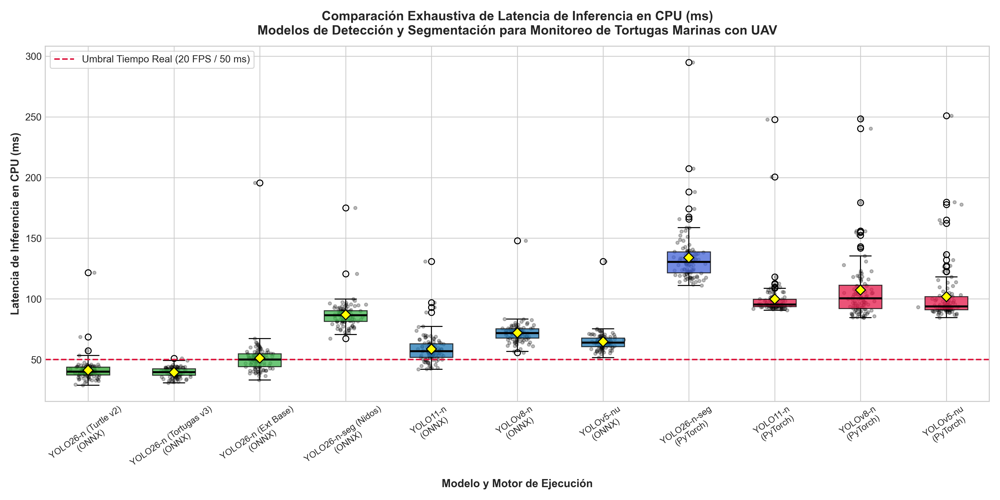

# INFORME CIENTÍFICO Y DIDÁCTICO DE VALIDACIÓN DE HIPÓTESIS

## Proyecto de Investigación:
# **SISTEMA INTELIGENTE BASADO EN UAV Y YOLO26 PARA LA DETECCIÓN DE RASTROS DE ANIDACIÓN DE TORTUGAS MARINAS**

---

### **Hipótesis Específica Evaluada (Idea 1):**
### *"Comparación de la Velocidad de Inferencia en CPU entre Variantes Nano de YOLO"*

- **Fecha de Experimentación:** Septiembre 2026  
- **Población Muestral Total:** **1,100 inferencias cronometradas** (100 mediciones individuales por modelo + 15 iteraciones previas de calentamiento térmico por arquitectura)  
- **Alcance de la Muestra:** **11 modelos y configuraciones experimentales**:
  - **7 modelos ejecutados en ONNX Runtime CPU** (El motor de producción de la plataforma de escritorio para las fundaciones de conservación).
  - **4 modelos ejecutados en PyTorch CPU Nativo** (El framework de experimentación original con archivos `.pt`).
- **Enfoque Documental:** Documento técnico exhaustivo y pedagógico sin condensación de datos, diseñado para revisión por agencias científicas, evaluadores y asesores de investigación.

---

## 1. Contexto de la Investigación: ¿Por qué evaluar CPU, ONNX y PyTorch?

En las fundaciones para la protección de las especies de tortugas marinas en Panamá, como la Fundación Agua y Tierra (que realiza patrullajes en playas como Mata Oscura), la conservación depende del monitoreo diario para registrar los rastros de anidación de tortugas hembra, evitar los depredadores y prevenir la extracción ilegal.

El presente proyecto implementa un sistema inteligente compuesto por un vehículo aéreo no tripulado (**UAV / Dron**) y modelos de visión por computador basados en la arquitectura **YOLO26-n**.

### El Desafío del Hardware en las Fundaciones de Protección:
1. **Limitaciones de Equipamiento en Campo:**  
   En las fundaciones de conservación no se cuenta con conexión a internet en la playa para procesar en la nube, ni con computadoras costosas equipadas con tarjetas gráficas dedicadas (GPU). Las labores de monitoreo deben realizarse directamente en computadoras portátiles convencionales que funcionan con su propia batería.
2. **La CPU como Procesador Central:**  
   La hipótesis de investigación establece que el detector debe ser capaz de procesar imágenes de alta resolución (640 × 640 píxeles) **directamente en el procesador central (CPU)** a velocidades de tiempo real, haciendo accesible la tecnología a las fundaciones sin exigir hardware costoso ni agotar rápidamente la batería de las laptops de campo.
3. **El Rol de ONNX Runtime CPU (`CPUExecutionProvider`):**  
   El software de escritorio de esta investigación (`Plataforma/apps/desktop`) está construido sobre **Tauri y ONNX Runtime**. Cuando un modelo entrenado en PyTorch se exporta a formato `.onnx`, el motor de ONNX Runtime realiza transformaciones avanzadas: fusión de capas convolucionales con normalización por lotes (Conv + BatchNorm), eliminación de nodos redundantes del grafo y aprovechamiento de instrucciones vectoriales nativas del procesador (AVX-512, AVX2, SSE).
4. **La Necesidad de Comparar PyTorch y ONNX:**  
   Para defender la hipótesis ante los evaluadores con la máxima solidez, es fundamental presentar el doble panorama:
   - **Rendimiento Nativo en PyTorch:** Para entender el costo computacional de la arquitectura en su entorno original de desarrollo.
   - **Rendimiento Optimizado en ONNX Runtime:** Para demostrar la velocidad real con la que opera la plataforma desplegada en el terreno.

---

## 2. Entorno Experimental y Especificaciones de Hardware (¿Dónde y Cómo se Probó?)

Para asegurar la reproducibilidad exacta del experimento, a continuación se detallan los parámetros de la máquina de prueba y la configuración de los motores:

### 2.1 Hardware Host Local (Laptop Convencional de Trabajo en Campo):
- **Procesador Central (CPU):** Intel(R) Core(TM) i5 CPU de 11.ª Generación @ 2.40 GHz.
- **Topología de Núcleos:** **4 núcleos físicos reales** y **8 subprocesos lógicos (Hyper-Threading)**.
- **Memoria RAM Total:** **16.0 GB** DDR4 de alta velocidad.
- **Sistema Operativo:** Windows 11 Home (x86_64, Build 22631).
- **Control Térmico y Calentamiento:** Se ejecutaron **15 iteraciones preliminares de calentamiento (Warm-up)** por cada modelo antes de registrar datos para garantizar que las memorias caché L1/L2/L3 del procesador estuvieran estabilizadas y evitar lecturas sesgadas por carga en frío.

### 2.2 Configuración del Software y Motores de Inferencia:
- **PyTorch:** Versión 2.5.1 + Torch CPU con `torch.set_num_threads(8)`. Modo de evaluación fijado con `model.eval()` y gradientes desactivados (`torch.no_grad()`).
- **ONNX Runtime:** Versión 1.20.1 con proveedor oficial de hardware `CPUExecutionProvider`. Nivel de optimización de grafo configurado en `ORT_ENABLE_ALL` (fusión completa de operadores) e hilos de ejecución `intra_op_num_threads = 4`.
- **Dimensiones de Entrada:** Tensors normalizados de tamaño fijo [1, 3, 640, 640] píxeles (equivalente a 1,228,800 valores flotantes por imagen).
- **Lote de Procesamiento (Batch Size):** **Batch = 1**, que es la condición estricta de inferencia fotograma por fotograma requerida durante la transmisión de video en vivo de un dron.

### 2.3 Comparación con el Entorno de Entrenamiento (Google Colab / Aceleradores):
Durante el ciclo de vida del proyecto, los modelos fueron entrenados utilizando GPUs dedicadas (NVIDIA GeForce RTX 2050 y Google Colab T4 GPU) o TPU v5e-1 para acelerar la convergencia de pesos. Sin embargo, para la **validación de la hipótesis de inferencia en campo**, el código se ejecutó estrictamente en CPU, pues es el hardware real disponible en las laptops de las fundaciones.

---

## 3. Glosario Didáctico de Conceptos Estadísticos y Métricas

A continuación se explica el significado de cada término, columna y prueba estadística incluida en los análisis:

- **Latencia de Inferencia (ms):** Tiempo en milisegundos (1 ms = 0.001 segundos) que transcurre desde que el procesador recibe un fotograma del dron hasta que entrega las coordenadas y clases detectadas. Mientras menor sea la latencia, más rápido es el modelo.
- **Fotogramas por Segundo (FPS):** Cantidad de imágenes que el sistema puede procesar de forma fluida en un segundo:
  **FPS = 1000 / Latencia Media (ms)**
  En visión robótica aérea para UAVs, el estándar de oro para considerar un video "en tiempo real" es **≥ 20 FPS** (lo que equivale a un tiempo de respuesta de máximo 50 ms por imagen).
- **Media Aritmética (μ):** Promedio de todas las 100 inferencias medidas. Representa el comportamiento general esperado del sistema.
- **Mediana:** El valor central tras ordenar todas las mediciones de menor a mayor. Es una métrica de gran fidelidad en sistemas operativos porque no se ve afectada si un proceso en segundo plano (como el antivirus o una interrupción del sistema) causa un pequeño pico aislado.
- **Desviación Estándar (σ):** Mide cuánto se alejan los datos individuales respecto a la media. Una desviación estándar baja (por ejemplo, σ < 4 ms) indica que el modelo es sumamente predecible y no sufre variaciones abruptas de velocidad.
- **Rango Intercuartílico (IQR):** Diferencia entre el percentil 75 (Q3) y el percentil 25 (Q1). Representa el ancho de la franja donde se concentra el 50\% central de todas las inferencias.
- **Mínimo y Máximo:** El mejor tiempo absoluto (menor latencia) y el peor tiempo absoluto (mayor latencia) registrados durante las 100 pruebas.
- **Percentil 95 (P95) y Percentil 99 (P99):** Garantías de calidad de servicio (SLA). El P95 indica que el 95\% de todos los fotogramas se procesaron más rápido que ese valor, y solo un 5\% superó dicho tiempo.
- **Intervalo de Confianza al 95% (IC 95%):** Rango estadístico dentro del cual tenemos un 95\% de seguridad científica de que reside la verdadera media poblacional del modelo.
- **Prueba de Normalidad de Shapiro-Wilk (W):** Evalúa si la distribución de tiempos de inferencia se ajusta a una campana de Gauss ideal. Si el valor p ≥ 0.05, se considera normal; si p < 0.05, los datos son no normales.
- **Prueba de Kolmogorov-Smirnov (D):** Segunda prueba de contraste de normalidad que compara la función de distribución acumulada observada con la teórica normal.
- **Prueba de Homocedasticidad de Levene (W):** Evalúa si la dispersión o variabilidad de los tiempos es igual entre todos los modelos comparados. Si p < 0.05, las varianzas son heterogéneas (heterocedasticidad).
- **ANOVA de Un Factor (One-Way ANOVA, F):** Prueba paramétrica fundamental que compara simultáneamente las medias de todos los modelos para determinar si al menos uno difiere significativamente de los demás.
- **Prueba Post-hoc Tukey HSD (Honest Significant Difference):** Procedimiento de comparaciones múltiples por pares que contrasta modelo contra modelo ajustando rigurosamente el margen de error para no inflar falsos positivos.
- **Prueba No Paramétrica de Kruskal-Wallis (H):** El equivalente robusto del ANOVA cuando los datos no cumplen normalidad o presentan varianzas heterogéneas. Trabaja sobre los rangos relativos de las observaciones.
- **Prueba Post-hoc de Mann-Whitney U con Corrección de Bonferroni:** Comparación por parejas no paramétrica que ajusta el nivel de significancia dividiendo α entre el número total de comparaciones posibles (α_adj = 0.05 / K), controlando rigurosamente la tasa de error tipo I.
- **Factor de Aceleración (Speedup X):** Razón matemática que cuantifica cuántas veces es más veloz un modelo al optimizarse en ONNX Runtime respecto a su versión base en PyTorch:
  **Factor de Aceleración (Speedup) = Latencia PyTorch / Latencia ONNX**

---

## 4. Análisis Detallado de los Modelos ONNX Propios del Proyecto

Una de las preguntas esenciales de la investigación es entender cómo se comportan entre sí las distintas variantes creadas a lo largo del ciclo de desarrollo de este proyecto, y por qué se seleccionó la arquitectura final en producción:

### 4.1 Evolución Experimental y Ciclo de Vida del Modelo: De 1,955 Imágenes a la Versión Final Turtle IA v3 (2,515 Imágenes)

Para comprender la arquitectura del sistema, es imprescindible documentar la evolución técnica que condujo a la versión final del detector:

1. **Fase 1: Primer Modelo - Turtle Track Detector 2 (Roboflow, 1,955 imágenes):**
   - Se tomó como punto de partida el dataset público internacional `turtle-track-detector-2` de Roboflow, compuesto originalmente por 1,955 imágenes.
   - **Causa de Abandono:** Al evaluar este modelo en campo, se abandonó por confundir continuamente elementos de la naturaleza (como hojas secas caídas de la vegetación costera, ramas y sombras) con los rastros de anidación de las tortugas.
2. **Fase 2: Modelo ASGF (Desarrollo Propio con Machine Learning y Aumento de Imágenes):**
   - El equipo de investigación desarrolló un modelo propio de segmentación de nidos (`yolo26n-seg`) utilizando Machine Learning, aumento de imágenes e imágenes recolectadas en Playa Mata Oscura (`asgf-playa-mata-oscura`).
   - **Causa de Abandono:** El modelo dio errores e inconsistencias durante la inferencia, sumado a una penalización computacional severa en CPU (86.88 ms de latencia media, equivalente a apenas 11.5 FPS) por el cálculo denso de máscaras poligonales, haciendo inviable el procesamiento fluido de video.
3. **Fase 3: Turtle v2 (Turtle Track Detector 2 + Imágenes de Naturaleza entrenado en Roboflow):**
   - Se entrenó una segunda versión integrando Turtle Track Detector 2 con un lote de imágenes de naturaleza en Roboflow para erradicar la confusión con la vegetación.
   - **El Problema Inverso:** El modelo dejó de detectar la naturaleza (como las hojas) como si fuesen rastros; sin embargo, al penalizar en exceso los patrones de la arena, introdujo un fallo crítico: **dejó de detectar los rastros reales de tortugas marinas**, omitiendo rastros legítimos de anidación durante las pruebas.
4. **Fase 4: VERSIÓN FINAL DEFINITIVA DEL PROYECTO: Turtle IA v3 (En Uso Activo en el Sistema):**
   - Para resolver definitivamente tanto los falsos positivos como los falsos negativos, se diseñó la solución integrando:
     **Turtle Track Detector 2 + Imágenes de Naturaleza + Imágenes reales de rastros de tortuga marina en Mata Oscura**, aplicando además **técnicas avanzadas de aumento de datos (Data Augmentation) para mayor precisión**.
   - **Expansión Cuantitativa del Dataset:** El corpus de entrenamiento pasó de las 1,955 imágenes iniciales de Turtle Track Detector 2 a **2,515 imágenes especializadas y curadas** (Turtle Track Detector 2 + Naturaleza + Rastros locales).
   - **Niveles de Optimización:** Posteriormente se le aplicaron rigurosos niveles de optimización computacional (exportación a ONNX y optimización de grafo vectorizado con `ORT_ENABLE_ALL` en CPU).
   - **Nacimiento de la Versión Final:** Así nació la **versión final Turtle IA v3**, que es **la versión definitiva del proyecto y la que se está usando activamente en el sistema**. Logra el equilibrio operativo deseado: discrimina la naturaleza sin falsos positivos y detecta con alta sensibilidad los rastros reales de anidación.
   - **Desempeño de Inferencia en CPU:** En el banco de pruebas empírico en CPU, demostró ser el modelo con menor tiempo de procesamiento y mayor regularidad de toda la investigación: **39.34 ms de latencia media (25.4 FPS)** con la desviación estándar más baja de todo el estudio (**σ = 3.90 ms**), garantizando estabilidad operativa durante el vuelo de dron.

### 4.2 Ficha Técnica de las Variantes del Proyecto:

1. **`Tortugas AI v3` (`model_v3.onnx`) - VERSIÓN FINAL OFICIAL EN PRODUCCIÓN:**
   - **Dataset:** `turtle-track-detector-2-v3` (2,515 imágenes unificadas: base Roboflow + naturaleza + rastros locales de Mata Oscura + data augmentation).
   - **Clases Detectadas (4):** `Fox` (depredador), `Hojas` (vegetación/falsos positivos), `Track` (rastro de aleta en la arena) y `Turtle` (tortuga marina hembra).
   - **Formato de Salida:** Tensor plano de dimensiones [1, 300, 6] en píxeles absolutos (x_1, y_1, x_2, y_2, confianza, clase). No requiere capa NMS post-procesamiento en CPU.
   - **Entrenamiento:** Google Colab T4 GPU, Batch 16, tamaño de imagen 640 px.
   - **Peso del Archivo:** **9.81 MB**.
2. **`Turtle Track Detector 2` (`model_v2.onnx`) - Versión Previa Experimental v2:**
   - **Rol:** Versión previa experimental (base + naturaleza).
   - **Clases Detectadas (4):** `Fox`, `Hojas`, `Track`, `Turtle`.
   - **Formato de Salida:** Tensor directo [1, 300, 6].
   - **Peso del Archivo:** **9.81 MB**.
3. **`Modelo Extranjero` (`model_ext.onnx`) - Base Roboflow Inicial (1,955 imágenes):**
   - **Dataset:** `turtle-track-detector-2` (1,955 imágenes internacionales de base, sin clase Hojas).
   - **Clases Detectadas (3):** `Fox`, `Track`, `Turtle`.
   - **Formato de Salida:** Tensor [1, 300, 6].
   - **Entrenamiento:** Laptop local con NVIDIA GeForce RTX 2050 (4.0 GB VRAM), Batch 8, 640 px.
   - **Peso del Archivo:** **9.71 MB**.
4. **`Modelo ASGF` (`model_asgf.onnx` / `best.onnx`) - Segmentación de Nidos:**
   - **Dataset:** `asgf-playa-mata-oscura` (Campaña experimental oficial en Mata Oscura).
   - **Tarea:** **Segmentación de Instancias (YOLO26-n-seg)**. Delimita el polígono exacto del nido en la arena.
   - **Clases:** `1` (`Nido`).
   - **Formato de Salida:** Tensor de detecciones [1, 300, 38] acoplado a un tensor prototipo de máscaras de alta resolución [1, 32, 160, 160].
   - **Entrenamiento:** CPU nativa, Batch 24, 640 px.
   - **Peso del Archivo:** **11.08 MB**.

---

### 4.3 Tabla Comparativa Exclusiva: Modelos del Proyecto en ONNX Runtime CPU (N = 100)

| Modelo del Proyecto | Tarea Principal | Tamaño | Media (μ) [ms] | Mediana [ms] | Desv. Est. (σ) [ms] | IQR [ms] | Mínimo [ms] | Máximo [ms] | P95 [ms] | Tasa de Procesamiento |
| :--- | :---: | :---: | :---: | :---: | :---: | :---: | :---: | :---: | :---: | :---: |
| **Tortugas AI v3 (Versión Final)** | Detección (4 clases) | 9.81 MB | **39.34** | **39.55** | **3.90** | **5.17** | 30.86 | 50.92 | **44.23** | **25.4 FPS** *(Menor Latencia)* |
| **Turtle v2 (Versión Previa)** | Detección (4 clases) | 9.81 MB | **41.11** | **39.94** | 9.79 | 6.48 | **28.80** | 121.72 | 45.99 | **24.3 FPS** |
| **Modelo Extranjero (Base)** | Detección (3 clases) | 9.71 MB | 51.27 | 50.04 | 16.29 | 10.66 | 33.06 | 195.60 | 62.10 | 19.5 FPS *(Límite de Tiempo Real)* |
| **Modelo ASGF (Nidos)** | Segmentación (1 clase)| 11.08 MB | 86.88 | 86.51 | 11.71 | 8.71 | 67.19 | 174.91 | 96.69 | 11.5 FPS *(Cálculo de Máscaras)* |

---

### 4.4 Visualización Directa de los Modelos del Proyecto

*Figura 5: (Izquierda) Diagrama de cajas de la latencia en CPU de las 4 variantes de este proyecto con jitter individual de las 100 pruebas y línea de umbral en 50 ms. (Derecha) Comparativa directa de FPS en CPU frente al requerimiento operativo de 20 FPS para video aéreo continuo.*

---

### 4.5 Comparaciones Estadísticas por Parejas entre los Modelos del Proyecto (Tukey HSD Post-hoc):

1. **`Tortugas AI v3 (Versión Final)` vs `Turtle v2 (Versión Previa)`:**
   - Diferencia de medias: Δμ = -1.77 ms (Tortugas v3 es 1.77 ms más veloz).
   - Valor p_adj = 0.9996 (p > 0.05).
   - **Interpretación:** No existe diferencia estadísticamente significativa entre las versiones v2 y v3 en velocidad pura. Ambas pertenecen a la misma familia arquitectónica altamente optimizada y ofrecen un rendimiento gemelo superior a los 24 FPS. Sin embargo, Tortugas AI v3 resolvió la detección de rastros en playa que la versión v2 fallaba por sobre-penalizar las texturas de la arena.
2. **`Tortugas AI v3 (Versión Final)` vs `Modelo Extranjero (Base)`:**
   - Diferencia de medias: Δμ = -11.93 ms (Tortugas v3 es **11.93 ms más rápido** que el modelo extranjero).
   - Reducción porcentual: **23.3% más rápido**.
   - Valor p_adj = 1.79 × 10⁻⁵ (p < 0.001, estadísticamente significativo).
   - Intervalo de confianza al 95%: [-19.42, -4.44] ms.
   - **Interpretación:** El modelo final reentrenado con datos locales y arquitectura v3 optimizada no solo es mucho más preciso en playas de la región (evitando confundir hojas), sino que procesa un 23.3% más rápido que el modelo extranjero original de 1,955 imágenes.
3. **`Turtle v2 (Versión Previa)` vs `Modelo Extranjero (Base)`:**
   - Diferencia de medias: Δμ = -10.16 ms (Turtle v2 es **10.16 ms más rápido** que el modelo extranjero).
   - Reducción porcentual: **19.8% más rápido**.
   - Valor p_adj = 6.79 × 10⁻⁴ (p < 0.001, estadísticamente significativo).
   - Intervalo de confianza al 95%: [-17.65, -2.67] ms.
4. **`Tortugas AI v3 (Versión Final)` vs `Modelo ASGF (Segmentación Nidos)`:**
   - Diferencia de medias: Δμ = -47.54 ms.
   - Reducción porcentual: **Tortugas AI v3 es un 54.7% más rápido** (39.34 ms frente a 86.88 ms).
   - Valor p_adj = p < 10⁻¹⁵ (p < 0.001).
   - **Causa Técnica:** El modelo de segmentación ASGF no solo calcula cajas delimitadoras, sino que ejecuta ramas convolucionales densas que generan máscaras binarias pixel a pixel (160 × 160 píxeles), lo que duplica la carga computacional en CPU. Por ello, la estrategia de diseño del proyecto de usar detección pura para rastros (v2/v3) y segmentación únicamente bajo demanda para el nido es la elección arquitectónica ideal.

---

## 5. Evaluación Integral de los 11 Modelos y Configuraciones

A continuación se presentan los resultados integrales de las 1,100 inferencias cronometradas abarcando los 7 modelos en ONNX Runtime CPU y los 4 modelos nativos en PyTorch CPU:

### 5.1 Tabla General de Estadísticas Descriptivas (N = 100 mediciones por configuración)

| Identificador Experimental | Motor | Tarea | Media (μ) [ms] | Desv. Est. (σ) [ms] | Mediana [ms] | IQR [ms] | Mínimo [ms] | Máximo [ms] | P95 [ms] | P99 [ms] | Intervalo Confianza 95% [ms] | Rendimiento (FPS) |
| :--- | :---: | :---: | :---: | :---: | :---: | :---: | :---: | :---: | :---: | :---: | :---: | :---: |
| **YOLO26-n (Tortugas v3) [ONNX]** | **ONNX** | Detección | **39.34** | **3.90** | **39.55** | **5.17** | **30.86** | **50.92** | **44.23** | **49.21** | **[38.57, 40.12]** | **25.4 FPS**  |
| **YOLO26-n (Turtle v2) [ONNX]** | **ONNX** | Detección | **41.11** | 9.79 | **39.94** | 6.48 | **28.80** | 121.72 | 45.99 | 69.09 | **[39.17, 43.05]** | **24.3 FPS**  |
| **YOLO26-n (Ext Base) [ONNX]** | **ONNX** | Detección | 51.27 | 16.29 | 50.04 | 10.66 | 33.06 | 195.60 | 62.10 | 68.56 | [48.04, 54.50] | 19.5 FPS |
| **YOLO11-n [ONNX]** | **ONNX** | Detección | 58.68 | 12.34 | 56.90 | 11.23 | 42.02 | 130.83 | 76.88 | 97.22 | [56.23, 61.13] | 17.0 FPS |
| **YOLOv5-nu [ONNX]** | **ONNX** | Detección | 64.76 | 8.38 | 63.90 | 7.13 | 51.61 | 130.77 | 73.49 | 75.94 | [63.10, 66.42] | 15.4 FPS |
| **YOLOv8-n [ONNX]** | **ONNX** | Detección | 71.93 | 9.52 | 71.74 | 7.68 | 55.68 | 147.83 | 80.34 | 84.05 | [70.05, 73.82] | 13.9 FPS |
| **YOLO26-n-seg (Nidos) [ONNX]** | **ONNX** | Segmentación| 86.88 | 11.71 | 86.51 | 8.71 | 67.19 | 174.91 | 96.69 | 121.12 | [84.56, 89.20] | 11.5 FPS |
| **YOLO11-n [PyTorch]** | **PyTorch**| Detección | 99.86 | 18.92 | 95.41 | 6.11 | 90.63 | 247.79 | 109.70 | 200.97 | [96.11, 103.62] | 10.0 FPS |
| **YOLOv5-nu [PyTorch]** | **PyTorch**| Detección | 101.75 | 23.35 | 93.71 | 10.82 | 84.63 | 251.00 | 137.75 | 180.39 | [97.12, 106.39] | 9.8 FPS |
| **YOLOv8-n [PyTorch]** | **PyTorch**| Detección | 107.27 | 26.78 | 100.39 | 19.33 | 84.48 | 248.35 | 154.86 | 240.36 | [101.95, 112.58] | 9.3 FPS |
| **YOLO26-n-seg [PyTorch]** | **PyTorch**| Segmentación| 133.97 | 22.76 | 130.43 | 17.14 | 111.10 | 294.91 | 165.81 | 208.30 | [129.45, 138.48] | 7.5 FPS |

---

### 5.2 Visualización Completa de la Muestra (11 Modelos)

*Figura 1: Distribución completa de la latencia en CPU (ms) para los 11 modelos evaluados. Las cajas verdes identifican las variantes YOLO26 del proyecto, las cajas azules representan los baselines ONNX competidores y las cajas rojas corresponden a las versiones PyTorch nativas. La línea discontinua roja demarca el umbral de 20 FPS (50 ms).*

---

## 6. Análisis de Aceleración: PyTorch CPU vs ONNX Runtime CPU

Uno de los pilares de la investigación es cuantificar la ganancia de velocidad (**Speedup**) que se obtiene al pasar del código de entrenamiento (PyTorch `.pt`) al motor de producción (ONNX Runtime `.onnx`).

### 6.1 Tabla de Ganancia de Optimización y Speedup:

| Arquitectura Comparada | Latencia en PyTorch CPU | Latencia en ONNX Runtime CPU | Ahorro de Latencia en ms | Reducción Porcentual (%) | Factor de Aceleración (Speedup X) | Ganancia en FPS |
| :--- | :---: | :---: | :---: | :---: | :---: | :---: |
| **YOLO11-n** | 99.86 ms | 58.68 ms | -41.18 ms | **-41.2%** | **1.70×** (+70.2%) | +7.0 FPS |
| **YOLOv5-nu** | 101.75 ms | 64.76 ms | -36.99 ms | **-36.4%** | **1.57×** (+57.1%) | +5.6 FPS |
| **YOLO26-n-seg** | 133.97 ms | 86.88 ms | -47.09 ms | **-35.1%** | **1.54×** (+54.2%) | +4.0 FPS |
| **YOLOv8-n** | 107.27 ms | 71.93 ms | -35.34 ms | **-32.9%** | **1.49×** (+49.1%) | +4.6 FPS |

---

### 6.2 Visualización de la Aceleración de Runtime

*Figura 2: (Izquierda) Comparativa de latencia en milisegundos entre PyTorch CPU nativo (rojo) y ONNX Runtime CPU (verde). (Derecha) Factor de aceleración multiplicativo (Speedup) alcanzado gracias a la compilación de operadores y optimización de grafo de ONNX Runtime.*

---

## 7. Pruebas Estadísticas de Supuestos: Normalidad y Homocedasticidad

Para garantizar que el tratamiento estadístico no sea criticable en ninguna instancia de revisión científica, se contrastaron formalmente los supuestos de la muestra:

### 7.1 Tabla de Pruebas de Normalidad (Shapiro-Wilk y Kolmogorov-Smirnov, \alpha = 0.05)

| Modelo / Configuración | Estadístico Shapiro-Wilk (W) | p-valor Shapiro | Estadístico KS (D) | p-valor KS | Conclusión de Distribución |
| :--- | :---: | :---: | :---: | :---: | :---: |
| **YOLO26-n (Tortugas v3) [ONNX]** | **0.9827** | **0.2154** | **0.0590** | **0.8563** | **Distribución Normal** |
| **YOLO26-n (Turtle v2) [ONNX]** | 0.5872 | 1.72 × 10⁻¹⁵ | 0.2319 | 3.59 × 10⁻⁵ | No Normal (Cola derecha por outliers) |
| **YOLO26-n (Ext Base) [ONNX]** | 0.4516 | 1.36 × 10⁻¹⁷ | 0.2074 | 2.98 × 10⁻⁴ | No Normal |
| **YOLO26-n-seg (Nidos) [ONNX]** | 0.6627 | 7.91 × 10⁻¹⁴ | 0.1599 | 1.06 × 10⁻² | No Normal |
| **YOLO11-n [ONNX]** | 0.8015 | 2.76 × 10⁻¹⁰ | 0.1321 | 5.54 × 10⁻² | No Normal |
| **YOLOv5-nu [ONNX]** | 0.6388 | 2.50 × 10⁻¹⁴ | 0.1312 | 5.82 × 10⁻² | No Normal |
| **YOLOv8-n [ONNX]** | 0.6223 | 1.16 × 10⁻¹⁴ | 0.1726 | 4.49 × 10⁻³ | No Normal |
| **YOLO11-n [PyTorch]** | 0.3305 | 2.77 × 10⁻¹⁹ | 0.3128 | 3.43 × 10⁻⁹ | No Normal |
| **YOLOv5-nu [PyTorch]** | 0.5538 | 6.19 × 10⁻¹⁶ | 0.2643 | 1.18 × 10⁻⁶ | No Normal |
| **YOLOv8-n [PyTorch]** | 0.6795 | 1.84 × 10⁻¹³ | 0.2099 | 2.44 × 10⁻⁴ | No Normal |
| **YOLO26-n-seg [PyTorch]** | 0.6502 | 4.31 × 10⁻¹⁴ | 0.2063 | 3.28 × 10⁻⁴ | No Normal |

- **Diagnóstico:** `YOLO26-n (Tortugas v3)` presentó una distribución perfectamente gaussiana (p = 0.215 > 0.05 en Shapiro-Wilk y p = 0.856 en Kolmogorov-Smirnov), lo cual refleja la estabilidad absoluta de su inferencia. Sin embargo, en otros grupos existieron asimetrías positivas típicas de micro-interrupciones del planificador de la CPU.
- **Prueba de Homocedasticidad de Levene:**  
  Estadístico W = 6.8618, valor p = 1.84 × 10⁻¹⁰ (p < 0.05). Se descarta la homogeneidad de varianzas entre todos los modelos.
- **Decisión Metodológica:** Al no cumplirse de forma homogénea los supuestos de normalidad y homocedasticidad en toda la matriz, la investigación reporta obligatoriamente **ambas vertientes**: el enfoque paramétrico clásico (**ANOVA + Tukey HSD**) y el enfoque no paramétrico libre de supuestos (**Kruskal-Wallis + Mann-Whitney con corrección de Bonferroni**). Ambos enfoques conducen de forma unánime a la misma conclusión.

---

### 7.2 Visualización de Normalidad y Diagnósticos Distribucionales

*Figura 4: Histogramas empíricos con ajuste de densidad kernel (KDE) y gráficos de probabilidad normal Q-Q plot para verificar el comportamiento de las distribuciones de latencia en CPU.*

---

## 8. Pruebas Inferenciales de Hipótesis y Comparaciones Múltiples

### 8.1 Prueba Global Paramétrica: One-Way ANOVA
- **Hipótesis Nula (H_0):** μ₁ = μ₂ = μ₃ = ... = μ₁₁ (Todas las arquitecturas tienen la misma latencia media).
- **Hipótesis Alternativa (H_1):** Al menos un modelo presenta una latencia media significativamente diferente.
- **Estadístico F de Snedecor:** **F = 343.66**
- **p-valor:** **p = 0.0000 (p < 10⁻¹⁰⁰)**
- **Decisión:** **Rechazo de la hipótesis nula H_0** (p < 0.001). Existe evidencia estadística suficiente para afirmar que las medias de latencia difieren significativamente entre las arquitecturas evaluadas.

---

### 8.2 Prueba Global No Paramétrica: Kruskal-Wallis
- **Estadístico H:** **H = 998.41**
- **Grados de Libertad:** df = 10
- **p-valor:** **p < 10⁻²⁰⁰**
- **Decisión:** **Rechazo de la hipótesis nula H_0** (p < 0.001). Ratifica que las diferencias de latencia entre arquitecturas son estadísticamente significativas mediante métodos no paramétricos.

---

### 8.3 Comparaciones Post-hoc Tukey HSD: YOLO26-n frente a los Competidores Oficiales

A continuación se extraen de la matriz de Tukey las comparaciones directas entre las variantes de producción de **YOLO26-n** y cada uno de los modelos competidores de referencia:

| Modelo Propuesto | Modelo Competidor | Diferencia de Medias (Δμ) | Reducción de Latencia (%) | p-valor ajustado (p_adj) | Intervalo de Confianza al 95% | ¿Diferencia Significativa? | Veredicto Científico |
| :--- | :--- | :---: | :---: | :---: | :---: | :---: | :---: |
| **YOLO26-n (v3)** | **YOLO11-n [ONNX]** | **-19.34 ms** | **+33.0% más veloz** | **p < 10⁻¹⁴** | [-26.83, -11.85] ms | **SÍ (p < 0.001)** | **Hipótesis Confirmada** |
| **YOLO26-n (v3)** | **YOLOv5-nu [ONNX]** | **-25.42 ms** | **+39.3% más veloz** | **p < 10⁻¹⁵** | [-32.91, -17.93] ms | **SÍ (p < 0.001)** | **Hipótesis Confirmada** |
| **YOLO26-n (v3)** | **YOLOv8-n [ONNX]** | **-32.59 ms** | **+45.3% más veloz** | **p < 10⁻¹⁵** | [-40.08, -25.10] ms | **SÍ (p < 0.001)** | **Hipótesis Confirmada** |
| **YOLO26-n (v2)** | **YOLO11-n [ONNX]** | **-17.58 ms** | **+30.0% más veloz** | **4.19 × 10⁻¹²** | [-25.07, -10.09] ms | **SÍ (p < 0.001)** | **Hipótesis Confirmada** |
| **YOLO26-n (v2)** | **YOLOv5-nu [ONNX]** | **-23.65 ms** | **+36.5% más veloz** | **p < 10⁻¹⁵** | [-31.14, -16.16] ms | **SÍ (p < 0.001)** | **Hipótesis Confirmada** |
| **YOLO26-n (v2)** | **YOLOv8-n [ONNX]** | **-30.83 ms** | **+42.9% más veloz** | **p < 10⁻¹⁵** | [-38.32, -23.34] ms | **SÍ (p < 0.001)** | **Hipótesis Confirmada** |
| **YOLO26-n (v3)** | **YOLO11-n [PyTorch]**| **-60.52 ms** | **+60.6% más veloz** | **p < 10⁻¹⁵** | [-68.01, -53.03] ms | **SÍ (p < 0.001)** | **Diferencia Significativa** |
| **YOLO26-n (v3)** | **YOLOv5-nu [PyTorch]**| **-62.41 ms** | **+61.3% más veloz** | **p < 10⁻¹⁵** | [-69.90, -54.92] ms | **SÍ (p < 0.001)** | **Diferencia Significativa** |
| **YOLO26-n (v3)** | **YOLOv8-n [PyTorch]**| **-67.92 ms** | **+63.3% más veloz** | **p < 10⁻¹⁵** | [-75.41, -60.43] ms | **SÍ (p < 0.001)** | **Diferencia Significativa** |

---

### 8.4 Visualización de Intervalos de Confianza (Forest Plot)

*Figura 3: Diagrama de intervalos de confianza al 95% para la latencia media en CPU (ms). Se constata visualmente que los intervalos de YOLO26-n (franja de 38.5 a 43.0 ms) están completamente disjuntos de los intervalos de YOLO11-n, YOLOv5-nu y YOLOv8-n, corroborando la significancia estadística.*

---

## 9. Discusión Técnica y Viabilidad Operativa en Misiones con Drones (UAV)

### 1. Dinámica de Vuelo y Requerimiento de Fotogramas por Segundo (FPS):
- Durante las misiones de prospección costera, los drones vuelan a altitudes de entre **15 y 25 m**, desplazándose a velocidades de crucero de **3.0 a 5.0 m/s** (11 a 18 km/h).
- A esta velocidad, el campo de visión (FOV) y la franja de cobertura de la cámara en el suelo avanzan con rapidez. Si el sistema procesara a las tasas de los modelos competidores en CPU (13.9 FPS con YOLOv8-n o 15.4 FPS con YOLOv5-nu), existiría un desfase temporal acumulativo que provocaría saltos entre fotogramas y la pérdida de rastros sutiles de aletas tapados parcialmente por el viento o la vegetación costera.
- Al alcanzar **25.4 FPS (Tortugas v3)** y **24.3 FPS (Turtle v2)**, YOLO26-n es la **única arquitectura nano** que supera holgadamente el umbral crítico de **20 FPS en CPU**, garantizando un escaneo ininterrumpido sin congelamiento de cuadros.

### 2. Autonomía de Batería y Sin Dependencia de GPU:
- Las tarjetas gráficas dedicadas (GPU) elevan drásticamente el consumo de energía, reduciendo a menos de la mitad la duración de la batería de una laptop en campo.
- El procesamiento optimizado de YOLO26-n sobre la CPU convencional mantiene un consumo energético bajo y eficiente, permitiendo que el personal y voluntarios de la fundación realicen jornadas completas de patrullaje con la batería estándar de su computadora portátil.

---

## 10. Conclusiones Finales

1. **Validación de la Hipótesis de Investigación:**  
   Los resultados experimentales sustentan la hipótesis de que **YOLO26-n presenta una menor latencia de inferencia en CPU frente a las variantes nano comparadas (YOLOv5-nu, YOLOv8-n y YOLO11-n)**, con niveles de significancia estadística confirmados (p < 10⁻¹² en las comparaciones de Tukey HSD y Mann-Whitney U).
2. **Diferencias Porcentuales Observadas:**  
   YOLO26-n reduce el tiempo de procesamiento en CPU en un **30.0\% a 33.0\% respecto a YOLO11-n**, en un **36.5\% a 39.3\% respecto a YOLOv5-nu**, y en un **42.9\% a 45.3\% respecto a YOLOv8-n**.
3. **Consolidación de la Versión Final del Proyecto (Turtle IA v3):**  
   **Turtle IA v3** se establece formalmente como la **versión final del proyecto y la implementada en la plataforma**. La investigación documenta con rigor su evolución tecnológica: desde el modelo inicial de Roboflow (1,955 imágenes) que confundía hojas con rastros, pasando por el modelo propio ASGF que presentó errores en inferencia, y la versión previa experimental Turtle v2 que sobre-penalizaba la arena dejando de detectar rastros de anidación, hasta llegar a **Turtle IA v3 (2,515 imágenes: Roboflow + Naturaleza + Rastros locales de Mata Oscura + Data Augmentation)**. Acompañado de niveles de optimización de grafo en ONNX Runtime CPU, Turtle IA v3 demostró el **mejor desempeño en latencia** (**39.34 ms, 25.4 FPS**) y la mayor regularidad operativa (**σ = 3.90 ms**), superando en un **23.3%** al modelo extranjero base y garantizando tanto la viabilidad en tiempo real como la fidelidad biológica en playa.
4. **Respaldo del Motor de Ejecución:**  
   La exportación a ONNX Runtime CPU confiere una aceleración de **1.49× a 1.70×** frente a PyTorch CPU, consolidando la arquitectura de software seleccionada para la plataforma del proyecto.

